<div align="center">

# 🌐 PulseGrid

**A geo-distributed, real-time alert fanout backend written in Rust.**

Deliver location-targeted alerts to only the devices that need them, over WebSockets, by routing on a geohash grid instead of broadcasting to everyone, and replay what a device missed when it comes back.


[](https://github.com/MuaazTasawar/pulsegrid/actions/workflows/ci.yml)

</div>

---

## Table of Contents

1. [Overview](#1-overview)
2. [The Problem](#2-the-problem)
3. [The Solution in One Paragraph](#3-the-solution-in-one-paragraph)
4. [System Architecture](#4-system-architecture)
5. [End-to-End Flows (Sequence Diagrams)](#5-end-to-end-flows-sequence-diagrams)
6. [Repository Layout & Crate Dependency Graph](#6-repository-layout--crate-dependency-graph)
7. [Core Algorithm: Geohash Shard Routing](#7-core-algorithm-geohash-shard-routing)
8. [Component Deep Dive](#8-component-deep-dive)
9. [Data Model](#9-data-model)
10. [Redis & NATS Key / Subject Reference](#10-redis--nats-key--subject-reference)
11. [Configuration Reference](#11-configuration-reference)
12. [Getting Started](#12-getting-started)
13. [API Reference](#13-api-reference)
14. [Authentication & Security Model](#14-authentication--security-model)
15. [Reliability & Failure Behavior](#15-reliability--failure-behavior)
16. [Observability](#16-observability)
17. [Testing](#17-testing)
18. [Load Testing & Results](#18-load-testing--results)
19. [CI & Containerization](#19-ci--containerization)
20. [Scaling Out: Running Multiple Workers](#20-scaling-out-running-multiple-workers)
21. [Known Limitations & Honest Caveats](#21-known-limitations--honest-caveats)
22. [Roadmap](#22-roadmap)
23. [Tech Stack Summary](#23-tech-stack-summary)
24. [Design Decisions & Trade-offs](#24-design-decisions--trade-offs)
25. [Troubleshooting](#25-troubleshooting)

---

## 1. Overview

PulseGrid is a backend for **location-scoped, real-time alerting**: earthquake early warnings, flash-flood alerts, neighborhood safety networks, anything where a message must reach *the people inside a geographic area, fast*.

It is a portfolio project built to show distributed-systems backend work in Rust: geospatial sharding, real-time fanout, backpressure-aware WebSocket delivery, durable replay for devices that were away, and security for long-lived connections. It is **not** a production emergency system; [§21](#21-known-limitations--honest-caveats) lists what it does not do, and [§18](#18-load-testing--results) explains how far the measurements can be trusted.

It is built as a **Cargo workspace of six members** that compile to **three runnable programs**:

| Program | Crate | Role |
|---|---|---|
| `api-coordinator` | `crates/api-coordinator` | Stateless HTTP API. Registers devices, issues tokens and one-time WebSocket tickets, accepts alerts from operators, resolves them to geohash shards, publishes them durably to NATS JetStream, serves the live dashboard. |
| `fanout-worker` | `crates/fanout-worker` | Stateful WebSocket server. Holds a lease on a set of shards, holds device connections, subscribes to NATS, pushes each alert to the local sockets that are inside the alert circle, replays missed alerts on reconnect. |
| `loadgen` | `crates/loadgen` | Load generator that registers devices, connects them through the ticket flow, fires alerts and measures end-to-end delivery latency. |

two **libraries** shared by those programs:

| Library | Role |
|---|---|
| `domain` | Pure business logic with no I/O: types, validation, tokens, geohash routing, the wire protocol shared by coordinator and worker. |
| `infra` | Adapters for Postgres, Redis, and NATS / JetStream. |

and one **test crate**:

| Crate | Role |
|---|---|
| `integration-tests` (`tests/`) | 35 integration and end-to-end tests that start real Postgres, Redis and NATS with `testcontainers`, and, for the end-to-end ones, run the real coordinator and worker in-process. |

---

## 2. The Problem

Detecting a hazard is a solved problem: sensors and threshold rules are well understood. The hard part is the **fanout**: getting a targeted message to potentially hundreds of thousands of nearby devices in seconds, and making sure a device that was briefly offline still learns about it.

The naive approaches fail:

| Naive approach | Why it fails |
|---|---|
| **Broadcast to every connected device** | Cost is O(all users) for every alert, no matter how small the affected area. Wasteful and slow. |
| **Query the DB for "who is nearby" on every alert** | A geospatial scan or join sits on the critical path of a time-critical message. Latency grows with table size. |
| **Fire and forget over plain pub/sub** | A device that is offline, reconnecting, or has a full buffer never sees the alert. |

PulseGrid targets this specific problem, the **routing, fanout and recovery infrastructure**, rather than the sensor or the "panic button".

## 3. The Solution in One Paragraph

Every device location is encoded as a **geohash**. The first **4 characters** of that geohash (a cell of about 39 km × 19.5 km) are the device's **shard prefix**. Each fanout worker holds a lease on a set of shard prefixes and holds the WebSocket connections for devices in them. When an operator sends an alert with a center and radius, the coordinator computes **which shard cells the circle overlaps** (BFS over geohash neighbors, pruned by haversine distance) and publishes **one durable NATS JetStream message per overlapping shard** on `alerts.geo.<prefix>`. Only workers owning those shards receive it. Each worker pushes it to the local sockets whose position is **inside the circle** and reports what it delivered. Devices acknowledge alerts; when a device reconnects, the worker replays what it missed from JetStream. Work scales with **the size of the affected area**, not with the total user base.

---

## 4. System Architecture

### 4.1 High-level component diagram

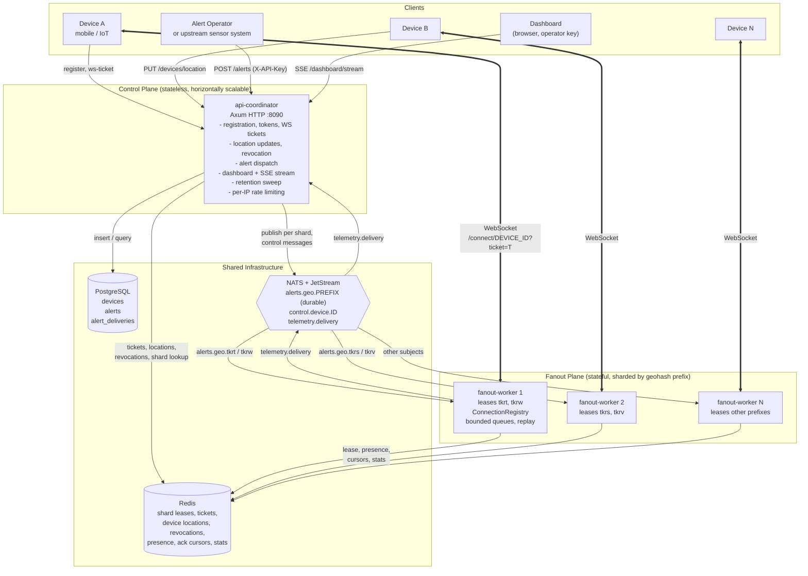

### 4.2 Architecture in plain ASCII (for terminals and offline viewing)

```
                              +----------------------------+
   register / ticket /  ----> |       api-coordinator      | <----  POST /alerts
   location (device JWT)      | Axum, tokens, tickets,     |        (operator key)
                              | rate limits, dashboard     | <----  browser dashboard
                              +----+----------+-------+----+
                                   |          |       |
                          devices, |          |       | tickets, locations,
                          alerts,  |          |       | revocations,
                          audit    |          |       | shard lookup
                              +----v---+  +---v-----+ +v---------+
                              |Postgres|  |  NATS   | |  Redis   |
                              +--------+  |JetStream| +----^-----+
                                          +---+-----+      |
                       alerts.geo.<prefix>    |            | shard lease, presence,
                       one durable message    |            | ack cursor, stats
                       per shard              |            |
                         +--------------------+---+--------+-----------+
                         |                        |                    |
                   +-----v-------+         +------v------+       +-----v-------+
                   |fanout-worker|         |fanout-worker|       |fanout-worker|
                   | tkrt, tkrw  |         | tkrs, tkrv  |       |     ...     |
                   | sockets in  |         |             |       |             |
                   | the circle  |         |             |       |             |
                   +-----+-------+         +------+------+       +------+------+
                         | WebSocket              | WebSocket           | WebSocket
                      devices                  devices               devices
```

### 4.3 Plane separation

| Plane | State | Scaling model | Failure impact |
|---|---|---|---|
| **Control** (`api-coordinator`) | Stateless; all state in Postgres/Redis/NATS | Add replicas behind any load balancer | A replica dying loses nothing |
| **Fanout** (`fanout-worker`) | Stateful: live sockets in process memory, shard leases in Redis | Partition by shard prefix; add workers and give them disjoint prefixes | A worker dying drops its sockets until clients reconnect; its leases expire and a replacement can claim the shards |
| **Data** (Postgres, Redis, NATS) | Durable (Postgres, JetStream file storage) or short-lived (Redis keys with TTLs) | Standard scaling for each | See [§15](#15-reliability--failure-behavior) |

---

## 5. End-to-End Flows (Sequence Diagrams)

### 5.1 Device registration

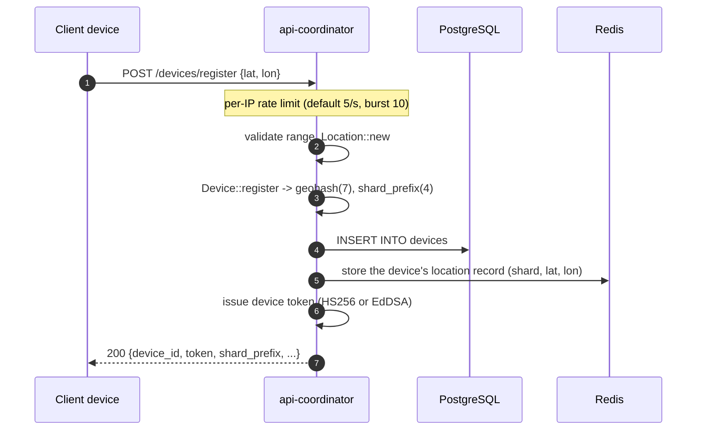

The device's **location record in Redis** is what the worker later trusts when the device connects; the client never tells the worker where it is.

### 5.2 Getting a ticket and opening the WebSocket

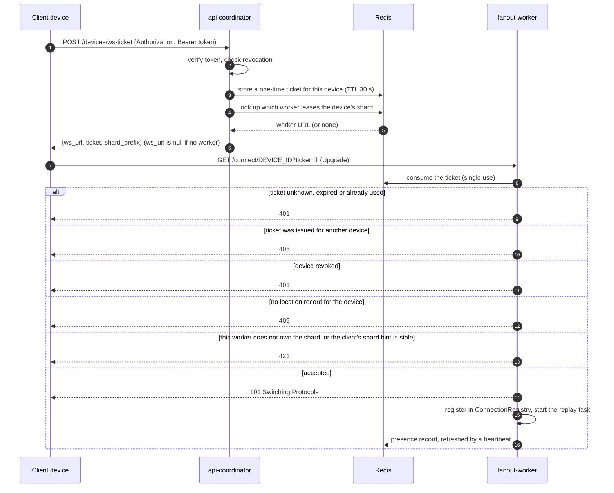

### 5.3 Alert dispatch and fanout (the main event)

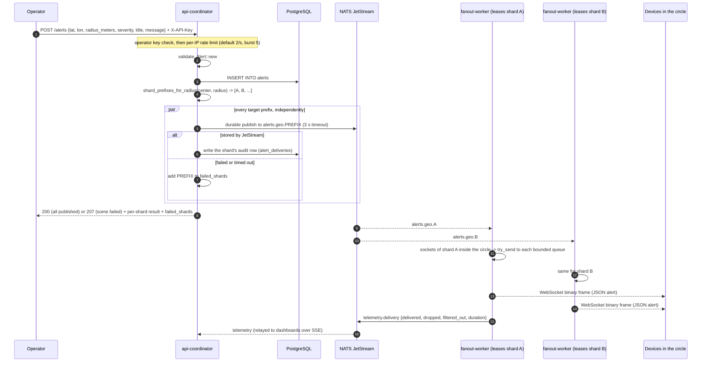

### 5.4 Location update and shard migration

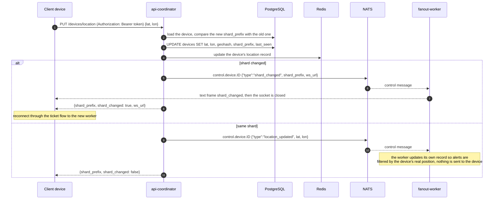

### 5.5 Reconnect and replay

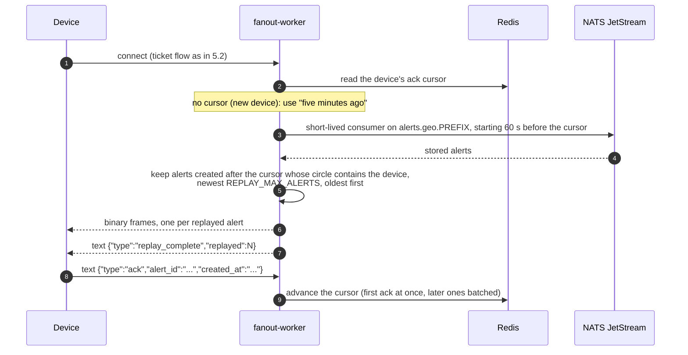

The 60-second margin exists because an alert's `created_at` comes from the coordinator's clock while JetStream orders by the server's clock; the exact cut is made on `created_at` afterwards.

### 5.6 Revocation

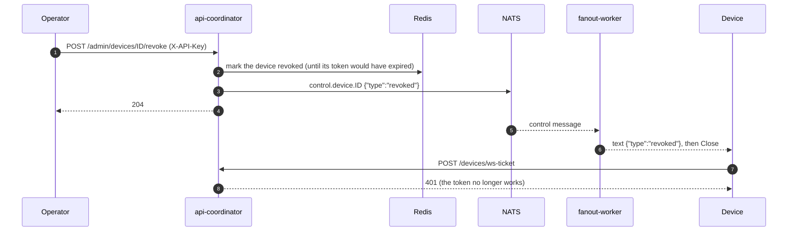

### 5.7 WebSocket connection lifecycle (worker side)

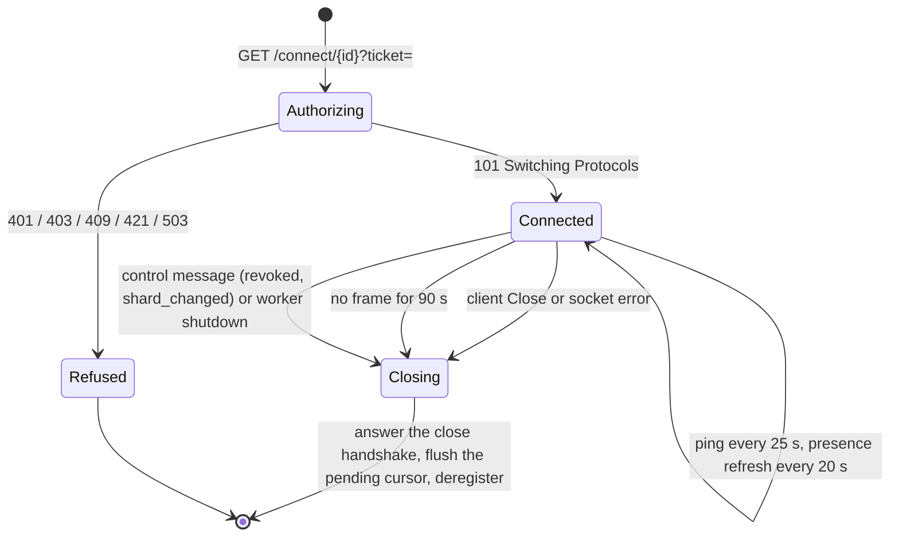

---
## 6. Repository Layout & Crate Dependency Graph

```
pulsegrid/
├── Cargo.toml                    # workspace root, shared [workspace.dependencies]
├── Cargo.lock
├── rust-toolchain.toml           # pins the Rust version (1.97) for local builds, CI and Docker
├── Dockerfile                    # multi-stage build -> both service binaries, non-root runtime
├── docker-compose.yml            # postgres + redis + nats (+ the two services)
├── docker-compose.scale.yml      # overlay: coordinator + two CPU-limited workers (used by bench.ps1)
├── .env.example                  # host-side (cargo run) configuration template
├── .env.docker.example           # container-side configuration template
├── migrations/                   # SQL migrations, embedded into the coordinator binary
├── .github/workflows/ci.yml      # lint, unit tests, integration tests, Docker build
├── scripts/
│   ├── gen-secrets.ps1          # creates or updates .env with real secrets
│   ├── smoke.ps1                # register -> ticket -> socket -> alert -> delivery
│   ├── replay-smoke.ps1         # acknowledge, go offline, miss an alert, get only that one
│   └── bench.ps1                # two-worker benchmark harness
├── bench-results/                # saved benchmark results (JSON, with machine details)
├── tests/                        # integration-tests crate (testcontainers)
│   ├── common/mod.rs            # harness: containers + in-process coordinator and worker
│   ├── alert_dispatch_test.rs, db_lifecycle_test.rs, redis_nats_test.rs
│   └── e2e_fanout_test.rs, replay_test.rs, security_test.rs, resilience_test.rs
└── crates/
    ├── domain/                   # pure logic, no I/O frameworks
    │   └── src/{alert,auth,device,errors,geo,protocol,lib}.rs
    ├── infra/                    # Postgres / Redis / NATS adapters
    │   └── src/{db,redis,nats,metrics,lib}.rs
    ├── api-coordinator/          # HTTP control plane
    │   ├── dashboard/{index.html,app.js,app.css}   # the live dashboard, embedded in the binary
    │   └── src/
    │       ├── main.rs, lib.rs, config.rs, errors.rs, metrics.rs
    │       ├── routes/{devices,alerts,admin,dashboard}.rs      # paths, auth layers, rate limits
    │       ├── handlers/{devices,alerts,admin,dashboard,ops}.rs
    │       ├── services/{device_service,alert_dispatch_service,
    │       │            retention_service,telemetry_service}.rs
    │       ├── extractors/{auth_device,operator_auth}.rs       # device JWT, operator API key
    │       └── middleware/{request_id,rate_limit}.rs
    ├── fanout-worker/            # stateful WebSocket plane
    │   └── src/{main,lib,config,ws,subscriber,connection_registry,control,
    │            lease,replay,rate_limit,ops,metrics}.rs
    └── loadgen/                  # load generator
        └── src/main.rs
```

### 6.1 Crate dependency graph

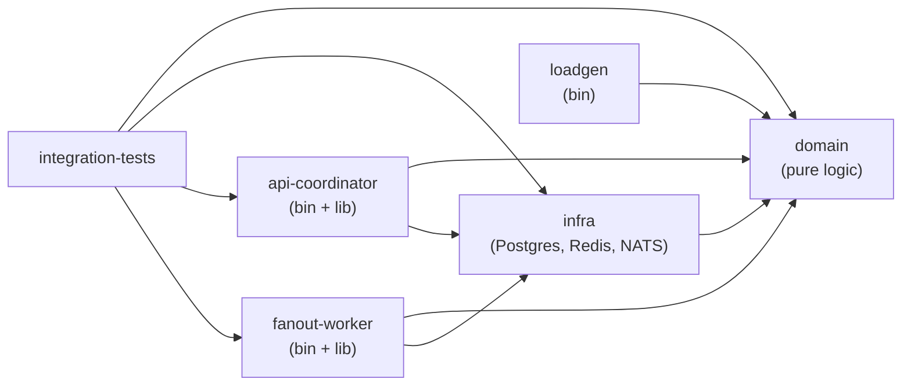

**Why `domain` is I/O-free:** both binaries and the test suite depend on it without pulling in Axum, sqlx, or NATS. Token logic, the NATS subject names and the WebSocket control messages (`domain::protocol`) live there on purpose, so the coordinator and the worker can never disagree about a token's shape, a subject name or a JSON message.

**Why the services are libraries too:** `api-coordinator` and `fanout-worker` expose `build_state`, `build_router` and `start_background_tasks`, so `main.rs` stays a thin wrapper and the end-to-end tests can run the real services in-process.

### 6.2 Layering inside `api-coordinator`

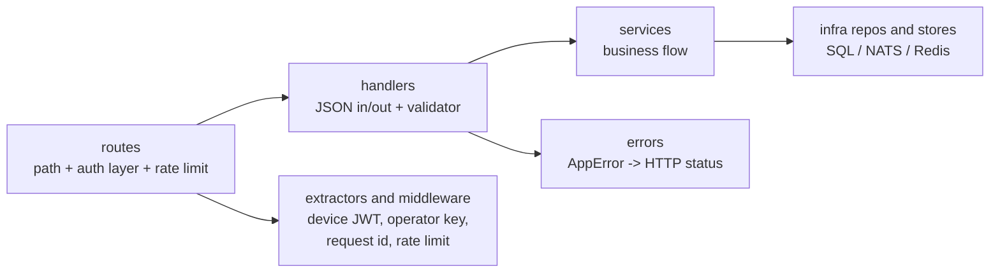

---

## 7. Core Algorithm: Geohash Shard Routing

Implemented in [`crates/domain/src/geo.rs`](crates/domain/src/geo.rs). This is the heart of the project.

### 7.1 Two precisions, two purposes

| Constant | Value | Approx. cell size | Purpose |
|---|---|---|---|
| `GEOHASH_PRECISION` | 7 chars | ~153 m × 153 m | Fine-grained device location identity (stored in `devices.geohash`) |
| `SHARD_PREFIX_LENGTH` | 4 chars | ~39 km × 19.5 km | Coarse **shard key**: decides which worker owns a device |

A device's shard prefix is simply the first 4 characters of its 7-character geohash. For example, the cell `tkrt` spans latitude 24.785 to 24.961 and longitude 66.797 to 67.148, which contains central Karachi.

### 7.2 Algorithm

Given `center` and `radius_meters` (valid range `(0, 500000]`):

1. **Encode** the center to its 4-char geohash cell.
2. **Compute how many rings of cells the circle can reach.** The circle's angular extent is `radius / Earth radius` in latitude and `asin(sin(extent) / cos(latitude))` in longitude (wider at high latitude; the whole globe if the circle reaches a pole). Measured in whole cells, `rings = max(floor(lat_extent / cell_height) + 1, floor(lon_extent / cell_width) + 1, 1)`. If `rings` exceeds `MAX_RING_EXPANSION` (100, only possible very near the poles) the request is rejected rather than silently under-covering the circle.
3. **BFS ring expansion**: starting from the center cell, repeat `rings` times: for every cell in the current frontier, add its 8 neighbors (N, NE, E, SE, S, SW, W, NW) that have not been visited. Newly discovered cells become the next frontier.
4. **Haversine prune**: grid expansion over-covers (cells are rectangles, alerts are circles). Keep a cell only if the great-circle distance from the alert center to the **cell's center** is `<= radius + slack`, where `slack = max(shortest cell side × √2, half the cell diagonal)`, measured at the latitude where cells are widest within the circle. The slack keeps cells that merely clip the circle.
5. **Return** the surviving prefixes. The coordinator publishes once to `alerts.geo.<prefix>` for each.

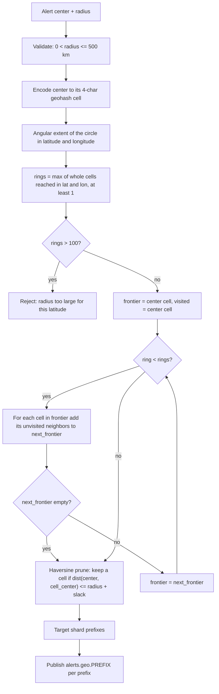

### 7.3 Visualizing the grid

A 5 km alert at the benchmark's default center (24.8607, 67.0011) is far smaller than one 39 km × 19.5 km cell, so `rings = 1` and the BFS yields the 3×3 neighborhood (9 cells). The haversine prune then drops the cells whose centers are too far away:

```
        before prune (9 cells)              after prune (this center)

      +-----+-----+-----+                 +-----+-----+-----+
      | nw  |  n  | ne  |                 |     | tkrw|     |
      +-----+-----+-----+                 +-----+-----+-----+
      |  w  |  C  |  e  |      ----->     |     | tkrt| tkrv|
      +-----+-----+-----+                 +-----+-----+-----+
      | sw  |  s  | se  |                 |     | tkrs|     |
      +-----+-----+-----+                 +-----+-----+-----+
                      C = cell containing the alert center (tkrt)
```

Four shards survive: the center cell and its north, east and south neighbors. The slack at this size is about 28 km, so the threshold is roughly 33 km. The centers of the north and south cells are about 21 km and 18 km away, the east cell's center is just inside the threshold (about 32.6 km by hand calculation), and the west cell's center is about 38 km away and is pruned. These distances are approximate; the benchmark logs confirm the outcome (`tkrt`, `tkrw`, `tkrs` and `tkrv` receive every alert, `tkrm`, the west neighbor, does not).

### 7.4 Complexity

Routing cost depends on **rings**, which depends on **radius / cell size**, not on the number of devices. Rings are bounded at 100, so at most `(2·100+1)² = 40,401` candidate cells in the worst case near the poles. In practice it is a handful.

### 7.5 What this does and does not guarantee

- ✅ **Coverage**: every cell the circle touches has its center within `radius + half a cell diagonal` of the alert center, and the slack is at least that, so a device inside the circle always lands in a targeted shard. The integration tests assert that a device's own shard is among its alert's targets, and `db_lifecycle_test` checks that the SQL circle queries agree with the Rust geometry.
- ✅ **Circle-accurate delivery**: routing only decides which workers get the message. Each worker then delivers only to sockets whose position is inside the circle (`filtered_out` in the telemetry counts the others). The end-to-end test sends an alert to a device 0 m from the center and checks that a device 6.7 km away, in the same shard, gets nothing.
- ⚠️ **Routing is loose.** The slack is deliberately generous, so for small circles the coordinator publishes to neighboring shards that hold no one inside the circle (three of the four, for the 5 km example above). It costs a few extra NATS publishes per alert and no extra deliveries. Measuring the distance from the center to the nearest point of each cell, instead of to its center, would be exact. This is a known improvement ([§22](#22-roadmap)).

---

## 8. Component Deep Dive

### 8.1 `domain`: pure logic

| Module | Contents |
|---|---|
| `device.rs` | `Location` (validated lat/lon), `DeviceId` (UUID newtype), `Device` with `register()` and `update_location()` (the latter returns whether the shard changed) |
| `alert.rs` | `AlertId`, `AlertSeverity {Info, Warning, Critical}`, `Alert::new` (validates radius and non-empty title), `target_shard_prefixes()`, `contains(point)` (great-circle distance within the radius), `nats_subject_for_prefix()` |
| `geo.rs` | Encoding, shard prefix, BFS ring expansion, haversine, cell bounds and sizes, bounding boxes for the SQL circle queries |
| `auth.rs` | `TokenSigner` / `TokenVerifier` (HS256 with a shared secret, or Ed25519 from PEM keys, via `jsonwebtoken`), `new_ws_ticket`, `ApiKeys` (operator keys, constant-time comparison), `validate_secret_strength` (production refuses weak or placeholder secrets) |
| `protocol.rs` | The contract between coordinator and worker: NATS subject names, `ServerMessage` (control frames sent to devices), `ClientMessage` (acknowledgements), `DeliveryTelemetry` |
| `errors.rs` | `AppError` plus `is_client_error()` so edge crates map to 4xx vs 5xx without duplicating logic |

### 8.2 `infra`: adapters

| Module | Contents |
|---|---|
| `db.rs` | `connect` (pooled), `run_migrations` (embedded), `DeviceRepository` (`insert`, `update_location`, `find_by_id`, `count_in_shard`, `count_in_shard_and_radius`, `list_in_circle`, `touch`, `delete`, `purge_inactive`, `count_all`), `AlertRepository` (`insert_alert`, `record_shard_delivery`, `get_alert`, `recent_alerts`, `list_deliveries`, `purge_older_than`). The circle queries use a bounding box (handling the antimeridian) plus an exact haversine test in SQL. |
| `redis.rs` | `ShardRegistry` (shard leases: acquire, refresh, release, `lookup_shard`), `WsTicketStore` (single-use tickets), `DeviceLocationStore` (the coordinator's record of where a device is), `RevocationStore`, `PresenceRegistry`, `AckCursorStore` (replay cursors that only move forward), `AlertStatsStore` (per-shard and total delivery counters). All on a `deadpool-redis` pool. |
| `nats.rs` | `connect`, `publish` (publish **and flush**, bounded by a **3 s timeout**), `ensure_alert_stream` (creates the `ALERTS` JetStream stream), `publish_durable` (waits for the server's acknowledgement), `replay_alerts` (short-lived consumer, clock-skew tolerant), `publish_control`, `publish_telemetry` |
| `metrics.rs` | Small hand-rolled Prometheus text helpers (counters, gauges), shared by both services |

### 8.3 `api-coordinator`: HTTP control plane

- **Routing, auth and rate limits.** Device routes are limited per client IP (registration 5/s burst 10, location 10/s burst 20 by default). Operator routes (alerts, admin, dashboard stream and device list) sit behind the `X-API-Key` check, and the rate limit is the **outer** layer so guessing keys is throttled too. Alert dispatch has its own tight limit (default 2/s, burst 5), via `tower_governor`.
- **Validation.** Request structs use `validator` (lat/lon ranges, radius `1..=500000`, title `1..=200` chars, message `1..=2000` chars), and the domain layer re-validates.
- **Error mapping.** `ApiError` wraps `AppError`: not found → 404, unauthorized → 401, forbidden → 403, conflict → 409, service unavailable → 503, other client errors → 400, everything else → 500 with a generic body (details are logged, not leaked).
- **Request IDs.** Middleware reads or generates `x-request-id`, echoes it on the response and puts it on the access-log line.
- **Graceful shutdown** on Ctrl+C / SIGTERM; the server is created with `ConnectInfo<SocketAddr>` so the rate limiter can see client IPs.
- **Startup order.** load config → connect Postgres and **run migrations** → connect NATS and **ensure the alert stream** → build the Redis pool → build the services → start background tasks (retention sweep, telemetry feed) → serve. It fails fast if a dependency is unreachable.
- **Retention.** A sweep every `RETENTION_SWEEP_INTERVAL_MINUTES` deletes devices that have been inactive longer than `DEVICE_RETENTION_DAYS` and alerts older than `ALERT_RETENTION_DAYS` (their audit rows go with them).
- **Telemetry feed.** One background task subscribes to `telemetry.delivery` and re-broadcasts each report in-process, so any number of dashboards can follow along without each one touching NATS. A dashboard that reads too slowly only loses its own events.

#### Dispatch behavior (`AlertDispatchService::dispatch`)

1. Validate and build the `Alert`; **persist it first** (`alerts` row).
2. Resolve target shard prefixes.
3. Serialize the alert **once** to JSON.
4. Publish to every prefix **in parallel** with a durable JetStream publish, each bounded by a 3 s timeout, so an outage costs one timeout rather than one per shard. On success write the shard's audit row; on failure add the prefix to `failed_shards`. One shard failing never stops the others.
5. Return `200` when `failed_shards` is empty, else **`207 Multi-Status`**.

### 8.4 `fanout-worker`: the stateful WebSocket plane

**Startup:** bind the listener first (so a client that learns about the worker the moment its lease appears can already connect) → connect Redis and NATS and ensure the alert stream → **acquire the shard leases** (fails if another live worker holds one of them) → spawn the lease refresher, **one NATS subscriber task per owned prefix**, and the control-message subscriber → serve HTTP/WS.

**`ConnectionRegistry`:** a concurrent map of device id to connection, plus an index from shard prefix to devices. Each entry holds the device's position (for the circle test), a **connection id** that tells generations apart, and the sender half of a **bounded queue**. When the same device connects again, the new connection replaces the old one, and the old connection's cleanup can no longer remove the new one. The alert payload is built once and shared, not copied per device.

**Backpressure design.** Fanout uses **`try_send`**, never `send().await`. The loop runs inside the shared subscriber task, so awaiting one slow client would stall every other device. A full queue means *that one device drops this alert*, and the loop moves on. The shard's result (`delivered`, `dropped`, `filtered_out`) is logged and published as telemetry.

**Per-connection tasks** (spawned in `handle_socket`):

| Task | Job |
|---|---|
| **Writer** | The only task that writes to the socket. Sends alerts as binary frames, control messages as text frames, a WebSocket ping every 25 s, and answers the close handshake. A write that takes longer than 10 s ends the connection. |
| **Reader** | Reads acknowledgements (any frame, including a pong, counts as activity) and notices the client leaving. |
| **Heartbeat** | Every 20 s refreshes the Redis presence record. Closes a connection that has sent nothing for 90 s. |
| **Replay** | One-shot: sends the alerts the device missed, then `replay_complete`. |

When the connection ends, the worker gives the writer up to 1 s to send its Close reply (aborting it immediately would reset the connection without a closing handshake), then aborts the tasks, writes the last pending acknowledgement, and cleans up the registry and the presence record, but only if they still belong to this connection.

**Acknowledgements and replay.** The first acknowledgement is written to Redis immediately; later ones are batched with the latest winning. An acknowledgement from the future is ignored and an older one never moves the cursor backwards. On connect the worker replays the alerts published for the shard after the device's cursor whose circle contains the device (see [§5.5](#55-reconnect-and-replay)).

**What the client receives:**

| Frame | Content |
|---|---|
| Binary | One alert as UTF-8 JSON: `id`, `center` (`lat`, `lon`), `radius_meters`, `severity`, `title`, `message`, `created_at` |
| Text | A control message: `{"type":"replay_complete","replayed":N}`, `{"type":"shard_changed","shard_prefix":"...","ws_url":"..."}` or `{"type":"revoked"}` |

**Graceful shutdown.** On SIGTERM or Ctrl+C the worker closes all sockets, waits up to 15 s for the server to finish, stops its tasks and **releases its shard leases**, so a replacement can claim the shards at once.

### 8.5 `loadgen`: the load generator

Registers N devices scattered uniformly over a disc around a center point, gets a ticket for each and connects to **the `ws_url` the coordinator names** (so several workers are used correctly). It waits until every device has finished its connect-time replay, sends warm-up alerts that are excluded from the statistics, then the measured alerts, one every `--interval-ms`. It reports delivery counts, duplicates, per-worker connection counts and latency percentiles (HdrHistogram), for delivery and for `POST /alerts` itself. Latency is the time from just before the alert request is sent to the moment the frame is decoded on the device's socket, all on one monotonic clock. With `--json` it prints a single JSON object, which `scripts/bench.ps1` saves.

### 8.6 The dashboard

`/dashboard` is a page embedded in the coordinator binary (`crates/api-coordinator/dashboard/`). It draws a Leaflet map. You click to place a circle, choose a radius and send an alert. Every delivery report from the workers arrives over Server-Sent Events and lights up the shard's cell: green when it delivered to live sockets, grey when it reached none, with a hover tooltip showing delivered, dropped, outside-the-circle counts and the fan-out time. A red ripple expands from the circle when an alert you sent is delivered. "Show devices in circle" draws the registered devices in the circle (at most 500 per request).

Design notes:

- The page reads `/dashboard/stream` with `fetch`, because the browser's `EventSource` cannot send the `X-API-Key` header. The key stays in the page's memory only.
- The page itself and its two assets are open (they contain no secrets); the stream and the device list need the operator key.
- The page is served with a strict **Content-Security-Policy**: scripts only from the server and the one pinned Leaflet release on cdnjs, connections only to the server, no framing. Everything the server sends is rendered with `textContent`, never as HTML.
- It needs internet access for the Leaflet files and OpenStreetMap tiles.

---

## 9. Data Model

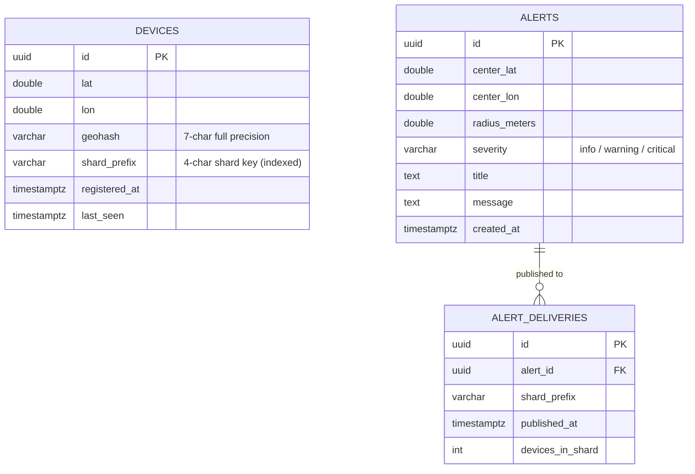

**Indexes:** `devices(shard_prefix)`, `devices(geohash)`, `alert_deliveries(alert_id)` (see `migrations/` for the full definition).

**`alert_deliveries` is the audit trail.** One row per shard an alert was *successfully published to*, written idempotently, with the device count at publish time. A statement like "this alert hit N shards covering M devices" should be computed by aggregating this table, not by trusting in-memory state. Shards that failed to publish get **no** row. Deleting an alert (retention) cascades to its rows.

**What Postgres does not hold:** the live state of delivery. Tickets, device locations, revocations, presence, replay cursors and delivery counters are short-lived Redis data, and the alert payloads that replay needs live in JetStream, not in Postgres.

Migrations live in `migrations/` and are embedded into the coordinator binary (`sqlx::migrate!`) and applied automatically on startup.

---

## 10. Redis & NATS Key / Subject Reference

### 10.1 Redis

Exact key names are an implementation detail of `crates/infra/src/redis.rs`; what matters is what each kind of data is for and how long it lives.

| Data | Written by | Lifetime | Purpose |
|---|---|---|---|
| `shard-worker:<prefix>` | fanout-worker (acquired at startup, refreshed, released on shutdown) | `SHARD_LEASE_TTL_SECS` (default 30 s), renewed while the worker lives | **Shard lease**: only one worker can hold a prefix, and the value is the worker's public WebSocket URL, which the coordinator hands out in tickets |
| `presence:<device_id>` | fanout-worker | 60 s, refreshed every 20 s | Which worker holds this device's socket. Powers `/admin/presence/{id}`. |
| WebSocket ticket | api-coordinator (issued), fanout-worker (consumed) | `WS_TICKET_TTL_SECS` (default 30 s), single use | Proves the coordinator authenticated the device a moment ago |
| Device location record | api-coordinator | device retention + 1 day | The device's shard and position as the coordinator knows them; the worker trusts this, never the client |
| Revocation mark | api-coordinator | token lifetime + 1 day | Blocks a revoked device's token |
| Replay cursor | fanout-worker | limited (`ACK_CURSOR_TTL_SECS` in `replay.rs`), so it expires if the device stays away long enough | The `created_at` of the latest alert the device acknowledged; only moves forward |
| Delivery counters | fanout-worker | limited (see `AlertStatsStore` in `redis.rs`) | Per-alert, per-shard counts of what the workers delivered (shown by `GET /alerts/{id}`) |

### 10.2 NATS and JetStream

| Name | Published by | Consumed by | Persistence | Purpose |
|---|---|---|---|---|
| `alerts.geo.<prefix>` | api-coordinator (durable JetStream publish) | fanout-worker that holds `<prefix>`; replay reads the stream | JetStream stream **`ALERTS`** (subjects `alerts.geo.>`, file storage, one replica), kept for `ALERT_STREAM_MAX_AGE_SECS` (default 3600) | One subject per shard. Live delivery uses a plain subscription; replay reads the stored copy. |
| `control.device.<device_id>` | api-coordinator | fanout-worker (subscribes to `control.device.*`) | core NATS, not persisted | Tells whichever worker holds a device's socket to forward a message or close it: `revoked`, `shard_changed`, `location_updated` |
| `telemetry.delivery` | fanout-worker | api-coordinator (relays to dashboards) | core NATS, fire and forget | One `DeliveryTelemetry` per shard per alert: `alert_id`, `shard_prefix`, `delivered`, `dropped`, `filtered_out`, `broadcast_duration_us`, `worker_id`, `at` |

---
## 11. Configuration Reference

All configuration is via environment variables (a `.env` file is loaded with `dotenvy` if present; real environment variables win over `.env`). `.env.example` is the template for host runs (`cargo run`); `.env.docker.example` is the template for containers. On Windows, `.\scripts\gen-secrets.ps1` creates or updates `.env` with real random secrets.

| Variable | Used by | Required | Default | Description |
|---|---|---|---|---|
| `PULSEGRID_ENV` | both | ❌ | `dev` | `dev` or `production`. In production, weak or placeholder secrets make the services **refuse to start**. |
| `DATABASE_URL` | coordinator | ✅ | none | Postgres connection string. The worker does **not** use Postgres. |
| `REDIS_URL` | both | ✅ | none | Redis URL (leases, tickets, locations, cursors, presence). |
| `NATS_URL` | both | ✅ | none | NATS URL. The server must have **JetStream enabled** (`-js`). |
| `JWT_SECRET` | coordinator | ✅ for HS256 | none | HS256 signing secret for device tokens (32+ characters in production). Not used when Ed25519 keys are configured. Only the coordinator needs it: workers authenticate sockets with tickets, not tokens. |
| `JWT_PRIVATE_KEY_PATH`, `JWT_PUBLIC_KEY_PATH` | coordinator | ❌ | unset | Use **Ed25519** instead of HS256: the coordinator signs with the private key and verifies with the public one. Set both or neither. |
| `DEVICE_TOKEN_TTL_HOURS` | coordinator | ❌ | `720` | Device token lifetime (30 days). |
| `WS_TICKET_TTL_SECS` | coordinator | ❌ | `30` | How long a WebSocket ticket stays valid (it is also single use). |
| `OPERATOR_API_KEYS` | both | ❌ | empty | Comma-separated operator keys, sent as `X-API-Key` (32+ characters in production). **Empty means every privileged call is refused.** |
| `COORDINATOR_PORT` | coordinator | ❌ | `8080` | HTTP listen port (`.env.example` sets `8090`). |
| `LOG_FORMAT` | both | ❌ | `pretty` | `pretty` or `json` (one JSON object per line). |
| `RATE_LIMIT_REGISTER_PER_SEC` / `_BURST` | coordinator | ❌ | `5` / `10` in `.env.example` | Registration limit: requests **per second** per client IP, plus a burst allowance. |
| `RATE_LIMIT_LOCATION_PER_SEC` / `_BURST` | coordinator | ❌ | `10` / `20` in `.env.example` | Limit for device calls such as location updates, and for operator reads. |
| `RATE_LIMIT_ALERTS_PER_SEC` / `_BURST` | coordinator | ❌ | `2` / `5` in `.env.example` | Limit for `POST /alerts`. |
| `RATE_LIMIT_DISABLED` | both | ❌ | `false` | `true` turns the rate limits off (**load testing only**). |
| `TRUST_PROXY_HEADERS` | both | ❌ | `false` | Take the client IP from `X-Forwarded-For` (only behind a proxy you control). |
| `DEVICE_RETENTION_DAYS` | coordinator | ❌ | `90` | Devices inactive for longer are deleted by the sweep. |
| `ALERT_RETENTION_DAYS` | coordinator | ❌ | `365` | Alerts (and their audit rows) older than this are deleted. |
| `RETENTION_SWEEP_INTERVAL_MINUTES` | coordinator | ❌ | `60` | How often the sweep runs. |
| `ALERT_STREAM_MAX_AGE_SECS` | both | ❌ | `3600` | How long alerts stay in the JetStream stream, i.e. how far back a device can be replayed. |
| `FANOUT_WORKER_PORT` | worker | ❌ | `8081` | HTTP/WS listen port. |
| `FANOUT_WORKER_SHARD_PREFIXES` | worker | ✅ | none | Comma-separated 4-char geohash prefixes this instance leases. At least one. |
| `WORKER_PUBLIC_URL` | worker | ❌ | `ws://localhost:<port>` | URL handed to clients in tickets (`ws://` or `wss://`). Set it to an address clients can reach. |
| `SHARD_LEASE_TTL_SECS` | worker | ❌ | `30` | How long a worker's claim on its shards survives if the worker stops renewing it. |
| `WS_CONNECT_RATE_PER_SEC` / `WS_CONNECT_BURST` | worker | ❌ | `50` / `100` | Limit on WebSocket connects per client IP. |
| `REPLAY_MAX_ALERTS` | worker | ❌ | `50` | Most alerts replayed on one connect (1 to 500); the newest are kept. |
| `RUST_LOG` | both | ❌ | `info` | `tracing` filter, e.g. `info,api_coordinator=debug,fanout_worker=debug`. |

**Default local ports** (from `docker-compose.yml` / `.env.example`):

| Service | Host port | Notes |
|---|---|---|
| PostgreSQL | `5435` → 5432 | Remapped to avoid clashing with a local Postgres |
| Redis | `6382` → 6379 | Remapped for the same reason |
| NATS | `4222` | Default client port; JetStream on |
| api-coordinator | `8090` | |
| fanout-worker | `8081` | |

---

## 12. Getting Started

### 12.1 Prerequisites

- **Rust**, version pinned by `rust-toolchain.toml` (currently 1.97). `rustup` installs it automatically the first time you build.
- **Docker** with Compose v2 (infrastructure, the integration tests, and the optional container build).
- **PowerShell** for the helper scripts in `scripts/` (Windows PowerShell 5.1 or PowerShell 7). Everything they do can be done with `curl`; see 12.3.
- Optional: [`websocat`](https://github.com/vi/websocat) for opening a WebSocket by hand.

### 12.2 Run locally

<details open>
<summary><b>Windows (PowerShell)</b></summary>

```powershell
git clone https://github.com/MuaazTasawar/pulsegrid.git
cd pulsegrid

docker compose up -d postgres redis nats      # infrastructure (NATS runs with JetStream)
.\scripts\gen-secrets.ps1                     # creates or updates .env with real secrets

cargo run -p api-coordinator                  # terminal 1: runs migrations on boot, port 8090
cargo run -p fanout-worker                    # terminal 2: leases the shards, port 8081
```

Scripts you download may need `Unblock-File .\scripts\<name>.ps1` before PowerShell will run them.
</details>

<details>
<summary><b>Linux / macOS (bash)</b></summary>

```bash
git clone https://github.com/MuaazTasawar/pulsegrid.git
cd pulsegrid
cp .env.example .env
# Edit .env: set JWT_SECRET and OPERATOR_API_KEYS, e.g. with  openssl rand -hex 32

docker compose up -d postgres redis nats
docker compose exec postgres sh -c 'until pg_isready -U pulsegrid; do sleep 1; done'

cargo run -p api-coordinator   # terminal 1
cargo run -p fanout-worker     # terminal 2
```
</details>

The start order does not matter any more: a device learns where to connect from its ticket (12.3), not from registration. If the worker says a shard is already leased by another process, stop that process or wait `SHARD_LEASE_TTL_SECS` (see [§25](#25-troubleshooting)).

### 12.3 Smoke test

**With the scripts** (PowerShell, with the coordinator and a worker running):

```powershell
.\scripts\smoke.ps1          # register -> ticket -> socket -> alert -> delivery
.\scripts\replay-smoke.ps1   # acknowledge A, go offline, alert B is sent, reconnect: only B is replayed
```

**By hand**, the full path:

**1. Register a device** (Karachi) and note `device_id`, `token` and `shard_prefix`:

```bash
curl -s -X POST http://localhost:8090/devices/register \
  -H "Content-Type: application/json" \
  -d '{"lat":24.8607,"lon":67.0011}'
# {"device_id":"c8b0...","token":"eyJ0...","shard_prefix":"tkrt", ...}
```

**2. Ask for a one-time ticket** (valid 30 s, usable once):

```bash
curl -s -X POST http://localhost:8090/devices/ws-ticket \
  -H "Authorization: Bearer <token>"
# {"ws_url":"ws://localhost:8081","ticket":"...","shard_prefix":"tkrt"}
```

**3. Open the WebSocket** on the `ws_url` you were given:

```bash
websocat "ws://localhost:8081/connect/<device_id>?ticket=<ticket>"
# first message you see: {"type":"replay_complete","replayed":0}
```

**4. Fire an alert** from another terminal (use a key from `OPERATOR_API_KEYS` in `.env`):

```bash
curl -s -X POST http://localhost:8090/alerts \
  -H "Content-Type: application/json" \
  -H "X-API-Key: <operator key>" \
  -d '{"lat":24.8607,"lon":67.0011,"radius_meters":5000,"severity":"critical","title":"Earthquake Warning","message":"Magnitude 5.2 detected nearby"}'
```

The JSON alert arrives on the WebSocket within a few tens of milliseconds, and the worker logs a line like:

```
INFO fanout_worker::subscriber: alert fanned out to shard shard=tkrt alert_id=... delivered=1 dropped=0 filtered_out=0 broadcast_duration_us=46
```

**5. Check presence** while the socket is open (operator key required):

```bash
curl -i -H "X-API-Key: <operator key>" http://localhost:8081/admin/presence/<device_id>
```

### 12.4 The live dashboard

Open `http://localhost:8090/dashboard`, paste an operator key and press **Connect**. The status line should read "connected, waiting for deliveries". Click the map, set a radius, press **Send alert**: each shard cell reports back. To see green cells, keep some devices connected, for example with `cargo run --release -p loadgen -- --devices 50 --alerts 100 --interval-ms 1000` (start the coordinator with `RATE_LIMIT_DISABLED=true` first, or it throttles the load generator, which holds its devices only while it runs). "Show devices in circle" draws the registered devices inside the circle.

### 12.5 Run everything in Docker

`docker-compose.yml` also defines `api-coordinator` and `fanout-worker` services built from the `Dockerfile`. Their `env_file` is `.env.docker`, the container-side configuration, which uses service names and container ports. The host-run `.env` uses `localhost` and host ports, which would be wrong **inside** containers. Create it once:

```powershell
.\scripts\gen-secrets.ps1 -Docker            # or:  copy .env.docker.example .env.docker
docker compose up -d --build
```

`gen-secrets -Docker` generates its own random secrets, different from the ones in `.env`, so do not mix a host-run coordinator with containerised workers. `docker-compose.scale.yml` reads the same `.env.docker` for all of its services (and repeats the three URLs); it is what `bench.ps1` uses.

### 12.6 Run the load test

```powershell
cargo run --release -p loadgen -- --devices 500 --alerts 30
```

Start the coordinator with `RATE_LIMIT_DISABLED=true`, otherwise registration is throttled. Use `--release`; debug builds distort latency numbers.

| Flag | Default | Meaning |
|---|---|---|
| `--coordinator` | `http://localhost:8090` | Where to register, get tickets and dispatch |
| `--operator-key` | `OPERATOR_API_KEYS` from the environment or `./.env` | Key for `POST /alerts` |
| `--devices` | `200` | Devices to register and keep connected |
| `--alerts` | `20` | Measured alerts to send |
| `--warmup-alerts` | `2` | Alerts sent first and excluded from the statistics |
| `--interval-ms` | `500` | Pause between alerts |
| `--lat` / `--lon` | `24.8607` / `67.0011` | Center of the device scatter and of every alert |
| `--spread-meters` | `3000` | Devices are placed uniformly within this radius |
| `--radius-meters` | `5000` | Alert radius (the spread must stay under 90% of it so every device is inside) |
| `--setup-concurrency` | `64` | Devices set up at the same time |
| `--drain-secs` | `5` | Keep listening this long after the last alert |
| `--replay-wait-secs` | `60` | Longest wait for the connect-time replay to finish on every device |
| `--keep-devices` | off | Do not delete the devices afterwards |
| `--json` | off | Print one JSON object instead of the text report |

### 12.7 Run the two-worker benchmark

```powershell
.\scripts\bench.ps1 -Devices 500 -Alerts 30
```

It starts `docker-compose.scale.yml` (the coordinator and two workers, each limited to one CPU, on disjoint shards), waits until all three are ready, runs `loadgen` in release mode, prints the result and saves it under `bench-results\` together with your CPU and memory. Stop natively running coordinator and worker processes first; ports and shard leases would clash. The default center sits on the border of two shards, so about half the devices connect to each worker. Results and their caveats are in [§18](#18-load-testing--results).

### 12.8 Run the tests

```powershell
cargo test --workspace --exclude integration-tests   # unit tests (no Docker)
cargo test -p integration-tests                      # needs Docker: starts throwaway Postgres, Redis, NATS
cargo test -p integration-tests --test e2e_fanout_test   # one file at a time
```

Set `PULSEGRID_TEST_LOG=1` and add `-- --nocapture` to see the services' logs from the end-to-end tests. See [§17](#17-testing).

---

## 13. API Reference

Base URLs (defaults): coordinator `http://localhost:8090`, worker `http://localhost:8081`.
All JSON errors from the coordinator have the shape `{"error": "<message>"}`. "Operator" means the `X-API-Key` header must hold one of `OPERATOR_API_KEYS`; "device" means `Authorization: Bearer <token>`.

| Method and path | Auth | Purpose |
|---|---|---|
| `POST /devices/register` | none (rate limited) | Register a device, get a token |
| `POST /devices/ws-ticket` | device | Get a one-time WebSocket ticket and the worker's URL |
| `PUT /devices/location` | device | Update the device's position |
| `DELETE /devices/me` | device | Deregister the device |
| `POST /alerts` | operator | Dispatch an alert |
| `GET /alerts`, `GET /alerts/{id}` | operator | Recent alerts; one alert with its delivery details |
| `POST /admin/devices/{id}/revoke` | operator | Block a device and close its socket |
| `DELETE /admin/devices/{id}` | operator | Deregister any device |
| `GET /dashboard`, `/dashboard/app.js`, `/dashboard/app.css` | none | The dashboard page and its assets |
| `GET /dashboard/stream` | operator | Server-Sent Events of delivery reports |
| `GET /dashboard/devices` | operator | Registered devices inside a circle |
| `GET /health`, `/ready`, `/metrics` | none | Operational endpoints (both binaries) |
| `GET /connect/{device_id}` (worker) | ticket | WebSocket upgrade |
| `GET /admin/presence/{device_id}` (worker) | operator | Which worker holds a device's socket |

### 13.1 `POST /devices/register`

Registers a device at a location and issues its token. **Rate limit:** default 5 req/s, burst 10, per client IP.

```jsonc
// Request
{ "lat": 24.8607, "lon": 67.0011 }

// Response 200 (further fields may be present)
{
  "device_id": "c8b00808-8462-459f-ac73-f59dbbe28f32",
  "token": "eyJ0eXAi...",
  "shard_prefix": "tkrt"
}
```

| Status | When |
|---|---|
| `200` | Registered |
| `400` | `lat` ∉ [-90, 90] or `lon` ∉ [-180, 180] |
| `429` | Rate limit exceeded |
| `500` | Database or other internal failure |

### 13.2 `POST /devices/ws-ticket`

Trades the device's token for a **single-use ticket** (valid for `WS_TICKET_TTL_SECS`, default 30 s) and tells it which worker to connect to. **Requires** `Authorization: Bearer <token>`.

```jsonc
// Response 200
{
  "ws_url": "ws://localhost:8081",   // null if no worker currently leases the device's shard
  "ticket": "…",
  "shard_prefix": "tkrt"
}
```

| Status | When |
|---|---|
| `200` | Ticket issued (check that `ws_url` is not `null`) |
| `401` | Missing, invalid or expired token, or the device was revoked |
| `429` | Rate limit exceeded |

### 13.3 `PUT /devices/location`

Updates the authenticated device's location. **Requires** `Authorization: Bearer <token>`.

```jsonc
// Request
{ "lat": 24.9, "lon": 67.1 }

// Response 200
{ "shard_prefix": "tkrt", "shard_changed": false, "ws_url": null }
```

If `shard_changed` is `true`, the device now belongs to a different shard. Its open socket is sent a `shard_changed` control message and then **closed**; the device must request a new ticket and reconnect to the new worker (`ws_url` in the response names it, and may be `null` if no worker leases the new shard yet).

| Status | When |
|---|---|
| `200` | Updated |
| `400` | Invalid coordinates |
| `401` | Missing, invalid, or expired token |
| `404` | Device id in token not found |
| `429` | Rate limit exceeded |

### 13.4 `DELETE /devices/me`

Deregisters the authenticated device. `204` on success; `401` without a valid token.

### 13.5 `POST /alerts`

Dispatches an alert to every shard overlapping the circle. **Requires** the operator key. **Rate limit:** default 2 req/s, burst 5, per client IP.

```jsonc
// Request
{
  "lat": 24.8607, "lon": 67.0011,
  "radius_meters": 5000,                 // 1 .. 500000
  "severity": "critical",                // "info" | "warning" | "critical" (lowercase)
  "title": "Earthquake Warning",         // 1..200 chars
  "message": "Magnitude 5.2 detected nearby"   // 1..2000 chars
}

// Response 200 (all shards published) or 207 (some failed), abridged
{
  "alert_id": "29be0c7d-...",
  "shards_targeted": 4,
  "total_devices_notified": 5,           // legacy field, see the note below
  "per_shard": [
    { "shard_prefix": "tkrt", "devices_in_shard": 5 },
    { "shard_prefix": "tkrw", "devices_in_shard": 0 }
  ],
  "failed_shards": []
}
```

| Status | When |
|---|---|
| `200` | Every targeted shard was published |
| `207` | Partial: one or more shards listed in `failed_shards` were **not** reached |
| `400` | Validation error |
| `401` / `403` | Missing or wrong operator key |
| `429` | Rate limit exceeded |

> **Reading `total_devices_notified`:** it is the sum of **registered devices** (Postgres rows) in the successfully published shards. It is a database count, **not** a count of live sockets that received the message. For live delivery use `GET /alerts/{id}` or the worker's telemetry (`delivered`, `dropped`, `filtered_out`).

### 13.6 `GET /alerts` and `GET /alerts/{id}`

Operator only. `GET /alerts?limit=N` lists the newest alerts first (default 20, at most 100). `GET /alerts/{id}` returns the alert, the shards it was published to, and what the workers reported delivering to live sockets. `404` for an unknown id.

### 13.7 Admin endpoints

| Endpoint | Effect |
|---|---|
| `POST /admin/devices/{id}/revoke` | The device's token stops working **at once** (`ws-ticket` answers `401`), and any open socket is sent `{"type":"revoked"}` and closed. The device record stays. `204` on success. |
| `DELETE /admin/devices/{id}` | Deregisters the device. `204` on success, `404` if unknown. |

### 13.8 Dashboard endpoints

| Endpoint | Auth | Notes |
|---|---|---|
| `GET /dashboard`, `/dashboard/app.js`, `/dashboard/app.css` | none | Static, embedded in the binary; the page carries a strict Content-Security-Policy |
| `GET /dashboard/stream` | operator | Server-Sent Events. One `delivery` event per shard per alert; a client that falls behind gets a `lagged` event with the number of events it missed |
| `GET /dashboard/devices?lat=&lon=&radius_meters=` | operator | Registered devices inside the circle, **at most 500** (the `limit` parameter can only lower that) |

```jsonc
// event: delivery   (data is one JSON object)
{ "alert_id": "...", "shard_prefix": "tkrt", "delivered": 50, "dropped": 0,
  "filtered_out": 0, "broadcast_duration_us": 146, "worker_id": "...", "at": "2026-11-01T11:13:25.62Z" }

// GET /dashboard/devices response
{ "devices": [ { "id": "...", "lat": 24.86, "lon": 67.0, "shard_prefix": "tkrt" } ],
  "truncated": false, "limit": 500 }
```

Device positions are personal data. The list is operator-only and capped on purpose.

### 13.9 `GET /connect/{device_id}?ticket=<ticket>` (WebSocket, worker)

Upgrades to a WebSocket. The one-time ticket from `POST /devices/ws-ticket` is the only credential; it travels in the query string, which is why it is single use and expires in seconds. An optional `shard_prefix=<prefix>` query parameter is a hint: if it disagrees with where the device really is, the connection is refused. The worker takes the device's real shard and position from the coordinator's record in Redis, never from the client.

| Status | When |
|---|---|
| `101` | Upgrade accepted |
| `401` | Ticket invalid, expired or already used; or the device is revoked |
| `403` | The ticket was issued for a different device |
| `409` | The device's location is not known (or invalid); request a new ticket |
| `421` | This worker does not own the device's shard (the JSON body may carry the right `ws_url`), or the client's `shard_prefix` hint is stale |
| `429` | WebSocket connect rate limit exceeded |
| `503` | A backend (Redis) is unavailable |

After the upgrade the worker first sends any replayed alerts as binary frames, then `{"type":"replay_complete","replayed":N}`. From then on:

| Direction | Frame | Content |
|---|---|---|
| server → device | binary | One alert as UTF-8 JSON (`id`, `center`, `radius_meters`, `severity`, `title`, `message`, `created_at`) |
| server → device | text | `{"type":"replay_complete","replayed":N}`, `{"type":"shard_changed","shard_prefix":"…","ws_url":"…"}`, `{"type":"revoked"}` |
| device → server | text | `{"type":"ack","alert_id":"…","created_at":"…"}`: echo the alert's `id` and `created_at`; the worker stores `created_at` as the replay cursor |
| both | ping / pong / close | The worker pings every 25 s, closes a connection silent for 90 s, and answers a client's close handshake |

### 13.10 Operational endpoints (both binaries)

| Endpoint | Response |
|---|---|
| `GET /health` | Liveness: `200` while the process is up |
| `GET /ready` | Readiness. The coordinator probes Postgres, Redis and NATS; the worker reports whether its shard subscriptions are up. Use it for load balancer and orchestrator checks. |
| `GET /metrics` | Prometheus text format, see [§16](#16-observability) |

### 13.11 `GET /admin/presence/{device_id}` (worker)

Operator only. Returns the `instance_id` of the worker holding that device's socket (`200`, plain text), or `404` `no presence record` if it is not connected or its heartbeat expired. `500` if Redis fails.

---

## 14. Authentication & Security Model

### 14.1 What exists today

| Control | Detail |
|---|---|
| **Device token** | Signed by the coordinator at registration, lifetime `DEVICE_TOKEN_TTL_HOURS` (default 30 days), `sub` = device UUID. **HS256** with `JWT_SECRET` by default; **Ed25519** with a key pair if `JWT_PRIVATE_KEY_PATH` / `JWT_PUBLIC_KEY_PATH` are set. |
| **One-time WebSocket tickets** | A token is never put in a URL. The device trades it over HTTP for a ticket bound to that device, valid for 30 s and usable once; the worker consumes it atomically. A ticket for device A cannot open a socket as device B (`403`). |
| **Server-side location** | The worker takes the device's shard and position from the coordinator's Redis record, not from the client. A client cannot claim another shard to receive its alerts. |
| **Operator API keys** | `X-API-Key` on `POST /alerts`, `GET /alerts*`, `/admin/*` (coordinator and the worker's `/admin/presence`) and the dashboard's stream and device list. Keys are compared in constant time. With no keys configured, every privileged call is refused. |
| **Revocation** | An operator can revoke a device: its token stops working at once, and a connected socket is told, then closed. |
| **Rate limiting** | Per client IP, per-second token buckets with a burst allowance, on registration, location updates, alert dispatch and operator reads; a separate limit on WebSocket connects. The rate limiter is the outer layer on operator routes, so key guessing is throttled. |
| **Production mode** | `PULSEGRID_ENV=production` refuses to start with weak, short or placeholder secrets and operator keys. |
| **Shard ownership and leases** | A worker refuses (`421`) devices of shards it does not hold, and only one live worker can hold a shard. |
| **Dashboard hardening** | Strict Content-Security-Policy, `nosniff`, no framing, key kept in page memory only, server data rendered as text. |
| **Input validation** | Range checks, length limits, enum-typed severity. |
| **Error hygiene** | 5xx responses return a generic message; details go to logs only. |
| **Shared protocol code** | One implementation in `domain`, so issuer and verifier, and publisher and subscriber, cannot diverge. |

### 14.2 What is not covered

These are real and worth knowing before any production use:

1. **No TLS in the repository.** Defaults are plain `http://` and `ws://`. Terminate TLS in front of both services (and set `WORKER_PUBLIC_URL` to a `wss://` address).
2. **Operator keys are shared static secrets.** There is no per-person identity, no audit of who sent which alert, and no rotation tooling beyond editing the environment and restarting.
3. **Registration is open** (rate limited only). Anyone who can reach the coordinator can register devices.
4. **HS256 is the default** and its secret is shared by whatever signs and verifies. Only the coordinator uses it today, but compromise of that secret allows forging tokens. Ed25519 is available.
5. **The dashboard shows real device positions** to anyone holding an operator key (capped at 500 per request), and loads Leaflet from cdnjs and tiles from OpenStreetMap.
6. **Behind a reverse proxy**, rate limiting sees the proxy's address unless `TRUST_PROXY_HEADERS=true` is set, and that must only be set when the proxy is trusted.
7. **Plain-text dev secrets.** `.env.example` ships placeholder secrets; production mode refuses them, dev mode does not.

---
## 15. Reliability & Failure Behavior

| Scenario | Behavior |
|---|---|
| **NATS unreachable during dispatch** | Every shard is published **in parallel**, each durable publish bounded by a **3 s timeout** (publish + server acknowledgement), so an outage costs one timeout, not one per shard. Failed shards are collected into `failed_shards`; the API returns **`207`** rather than hanging or aborting. Unit tests cover the timing; the original behavior was also verified by stopping the NATS container mid-request. |
| **No JetStream stream captures the subject** | The durable publish fails fast instead of hanging (covered by `redis_nats_test`). |
| **One shard fails, others succeed** | Shards are attempted independently, so the others are still delivered. |
| **Audit write fails after a successful publish** | Logged as an error; delivery is not rolled back. |
| **Slow or stalled WebSocket client** | Its bounded queue fills; further alerts to **that device** are dropped (`dropped` counter in the telemetry). Other devices are unaffected. |
| **Device offline or reconnecting when an alert is sent** | It does not get the live push, but the alert is stored in JetStream. On reconnect the worker replays what the device missed: the alerts after its acknowledgement cursor (or the last five minutes for a new device) whose circle contains it, newest `REPLAY_MAX_ALERTS`, within `ALERT_STREAM_MAX_AGE_SECS`. Covered by `replay_test`. |
| **Publisher and NATS server clocks disagree** | Replay reads the stream from 60 s before the cursor and makes the exact cut on the alert's own `created_at`, so an alert is not skipped (covered by `redis_nats_test`). |
| **Redis unavailable when a device connects** | The upgrade is refused with `503`; the device retries with a new ticket. |
| **Redis unavailable for presence or the replay cursor** | Logged as warnings; the connection continues. Presence is for visibility, and a cursor that cannot be written only means a possible repeat on the next replay. |
| **Worker stopped gracefully (deploy)** | All sockets are closed with a proper Close frame, shard leases are released, and a replacement worker (new port allowed) can claim the shards at once. Devices ask for a new ticket and are sent to the new address. An alert sent while no worker was running is replayed to the device by the new worker (covered by `resilience_test`). |
| **Worker crashes** | Its sockets drop. Its leases expire after `SHARD_LEASE_TTL_SECS` (default 30 s) and presence records within 60 s. Until the lease expires, tickets still name the dead worker's address, so reconnects fail and should be retried. |
| **No worker leases a device's shard** | `POST /devices/ws-ticket` answers with `ws_url: null`; the device retries later (covered by `resilience_test`). |
| **Same device connects twice** | The newer connection replaces the older one, and the older one's cleanup can no longer remove the newer one's registration. |
| **Silent connection** | A connection that sent nothing (not even a pong) for 90 s is closed. |
| **Client closes the socket** | The worker answers the close handshake (it gives its writer up to 1 s to send the Close reply), stores the last pending acknowledgement, and cleans up the registry and presence record, but only if they still belong to this connection. |
| **Device revoked while connected** | The device receives `{"type":"revoked"}` and is disconnected; its token no longer buys a ticket (covered by `security_test`). |
| **Postgres, Redis or NATS down for longer** | The coordinator reports not ready on `/ready`. Beyond the cases above this has **not** been tested end to end. |
| **Graceful shutdown** | Both binaries handle Ctrl+C and SIGTERM. The worker closes its sockets, waits up to 15 s, and releases its leases. |

**Delivery semantics:**

- **Live delivery is best effort.** A device with a full queue, or no connection, does not get the live push.
- **Replay recovers misses** when the device reconnects, as long as the alert is still in the stream and within the replay limit.
- **There is no exactly-once promise.** The tests check that an acknowledged alert is not sent again and that exactly the missed one is, but the protocol does not guarantee it under every failure.
- **Durability rests on one NATS server** in the provided Compose files.

---

## 16. Observability

### 16.1 Logging

Structured `tracing` logs, controlled by `RUST_LOG` (default `info`); `LOG_FORMAT=json` gives one JSON object per line. Key events:

| Component | Event | Fields |
|---|---|---|
| worker | `alert fanned out to shard` | `shard`, `alert_id`, `delivered`, `dropped`, `filtered_out`, `broadcast_duration_us` |
| worker | `device connected` / `device disconnected` | `device_id`, `shard`, `connections` |
| worker | `replayed missed alerts` | `device_id`, `replayed` |
| worker | `closing a silent connection`, `connection refused` | `device_id`, reason |
| worker | `starting fanout-worker`, `shard leases acquired`, `shard leases released` | `instance_id`, `shards`, `url`, `ttl_secs` |
| coordinator | one access-log line per request at `INFO` | `method`, `path`, `request_id`, `latency`, `status` |
| coordinator | `subscribed to delivery telemetry`, `retention sweep` | |
| both | warnings for degraded dependencies (presence, cursor writes, slow database pool) | error details |

The coordinator adds an `x-request-id` header (generated or passed through) to every response, and the id appears on the access-log line, for correlation.

### 16.2 Metrics (Prometheus text format)

Both binaries serve `/metrics`. The worker exposes the live connection gauge plus counters for connects, refused connects by reason, acknowledgements and replay activity; the coordinator exposes HTTP request metrics, dispatch metrics and admin counters. Metrics are intentionally hand-rolled (no metrics crate) to keep the dependency surface small; the exact names are in `crates/*/src/metrics.rs`.

### 16.3 Health

`/health` (liveness) and `/ready` (readiness) exist on both services. The coordinator's `/ready` probes Postgres, Redis and NATS; the worker's reports whether its shard subscriptions are up. `scripts/bench.ps1` waits on them.

### 16.4 The dashboard as a live view

`/dashboard` ([§8.6](#86-the-dashboard)) is the quickest way to see what the workers are doing: one report per shard per alert with delivered, dropped and filtered-out counts and the fan-out time.

---

## 17. Testing

| Layer | Where | What it covers |
|---|---|---|
| **Unit** | inside each crate (the coordinator has 36, the worker 30, plus `domain` and `infra`) | Routing geometry, config validation, rate limiting, request ids, replay cursor logic (batching, future and older acknowledgements), connection registry and backpressure, control-message handling, the dashboard's content policy and limits, dispatch failure isolation and timing |
| **Integration** | `tests/alert_dispatch_test.rs`, `tests/db_lifecycle_test.rs` (7 tests) | A real Postgres via `testcontainers`: the routing claim (a device's shard is among its alert's targets), circle queries including across the antimeridian and agreement with the Rust geometry, retention purge and cascades, idempotent audit rows |
| **Integration** | `tests/redis_nats_test.rs` (15 tests) | Real Redis and NATS with JetStream: exclusive, refreshable, expiring shard leases; single-use tickets; revocation; delivery counters; forward-only ack cursors; durable publish and replay since a timestamp, clock-skew handling, limits and shard isolation; control and telemetry messages |
| **End to end** | `tests/e2e_fanout_test.rs` (4 tests) | The real coordinator and worker: an alert reaches the device inside the circle and not one 6.7 km away in the same shard; delivery reports reach `/dashboard/stream`; `/dashboard/devices` lists the right devices; the page is served |
| **End to end** | `tests/replay_test.rs` (3 tests) | Acknowledge A, close cleanly (the worker answers the close handshake), miss B, reconnect and get exactly B; a new device is sent the recent alerts of its area; and not alerts for other places |
| **End to end** | `tests/security_test.rs` (4 tests) | Every operator endpoint (including both dashboard ones) refuses a missing or wrong key; device endpoints refuse missing or forged tokens; a ticket works once and only for its own device; revoking a device tells it, closes its socket and blocks new tickets |
| **End to end** | `tests/resilience_test.rs` (2 tests) | The worker stops and a new one starts on another port: an alert sent in between is replayed; with no worker a device is told there is no address, and gets one again when a worker returns |
| **Manual / live** | `scripts/smoke.ps1`, `scripts/replay-smoke.ps1`, the dashboard | The same paths against live processes |

**35 integration and end-to-end tests** in total. The end-to-end tests share a harness (`tests/common/mod.rs`): `Stack::start()` starts a fresh Postgres, Redis and NATS (JetStream) with `testcontainers`, then the real coordinator and worker in the test process on random ports, and gives the test helpers for registering devices, getting tickets, opening sockets, sending alerts and reading Server-Sent Events. Each test gets its own world, so tests cannot interfere; at most two stacks run at the same time so that a laptop is not asked to start fifteen containers at once.

```powershell
cargo test --workspace --exclude integration-tests          # unit tests, no Docker
cargo test -p integration-tests                             # needs Docker
cargo test -p integration-tests --test security_test        # one file
$env:PULSEGRID_TEST_LOG='1'; cargo test -p integration-tests --test replay_test -- --nocapture   # with service logs
```

**Not covered by automated tests:** real mobile networks and devices, TLS, multi-host deployment, and failure of Postgres, Redis or NATS beyond the cases in [§15](#15-reliability--failure-behavior).

---

## 18. Load Testing & Results

> **Read this with the caveats.** All numbers below come from **one run on one Windows machine** where the load generator, Docker, the databases and the desktop shared the same CPUs. They show that the system works at this load. They are not a capacity figure.

### 18.1 Methodology

`loadgen` ([§8.5](#85-loadgen-the-load-generator)) registers N devices with real tokens, gets a ticket for each, connects them over WebSocket to the worker named in the ticket, waits until every device has finished its connect-time replay, sends 3 warm-up alerts (not counted) and then the measured alerts, one every 500 ms, each covering all devices. For every delivery it records the time from **just before the `POST /alerts` request is sent** to **the moment the frame is decoded on the device's socket**, on one monotonic clock in one process, so there is no clock skew. That includes the coordinator (HTTP, database, NATS publish) and the worker's fan-out. It does not include real networks.

### 18.2 The harness

`.\scripts\bench.ps1 -Devices 500 -Alerts 30` starts `docker-compose.scale.yml`: the coordinator and **two workers, each limited to 1 CPU**, on disjoint shards (worker A leases `tkrt` and `tkrw`, worker B leases `tkrs` and `tkrv`), with Postgres, Redis and NATS in Docker. `loadgen` runs on the host. The default center sits on the border of `tkrt` and `tkrs`, so devices land on both workers.

### 18.3 Result

500 devices, 30 measured alerts every 500 ms. The saved result, including the machine's CPU and memory, is in `bench-results/`.

| Measure | Value |
|---|---|
| Devices connected | 500 (244 on worker A, 256 on worker B), 0 failed |
| Deliveries | 15,000 of 15,000 expected (100%), 0 duplicates |
| Delivery latency (request sent → frame received) | p50 **28.4 ms**, p90 66.5 ms, p99 203.7 ms, p99.9 269.3 ms, max 270.6 ms |
| `POST /alerts` response time | p50 46.0 ms, p90 113.4 ms, p99 400.9 ms |
| Offered load | about 1,000 deliveries per second for 14.8 s (500 devices × 2 alerts per second; **not** a ceiling) |

Frames reach the devices before the HTTP response returns, which is why delivery latency is lower than the `POST` time. The delivery tail follows the `POST /alerts` tail, which points at the coordinator path rather than the workers: the worker logs show fan-out to 50 sockets taking about 0.1 to 0.9 ms per shard. That reading comes from the logs; no separate experiment isolated it.

### 18.4 What this does not show

- **Capacity.** One load level, one run. No repeats, so no estimate of run-to-run variance.
- **Higher device counts.** Earlier versions of this README listed results up to 5,000 devices; they described a previous design (token in the URL, no replay) and are not repeated. To extend the measurement: `.\scripts\bench.ps1 -Devices 1500 -IntervalMs 250`.
- **Separate hosts.** The load generator and the services shared one machine.
- **Real networks, TLS, or failure of Postgres, Redis and NATS.**
- **Registration speed.** Registering 64 devices at once took 0.6 to 2.5 s each on this machine, with sqlx warnings that waiting for a database connection exceeded two seconds. That is the setup path, not alert delivery, and it suggests a small database pool for a burst.

---

## 19. CI & Containerization

### 19.1 GitHub Actions (`.github/workflows/ci.yml`)

Triggers on push and pull request to `main`. A newer push to the same branch cancels the older run. All jobs use the Rust version pinned in `rust-toolchain.toml` (1.97).

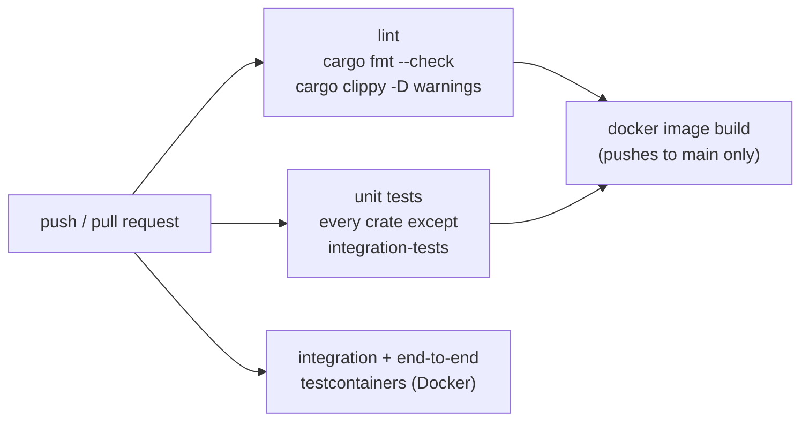

The integration job runs on GitHub's Ubuntu runners, which have Docker; each test starts its own containers, so it is the slowest job.

### 19.2 Dockerfile

Two stages:

1. **Builder** (`rust:1.97-slim-bookworm` + `pkg-config`, `libssl-dev`): `cargo build --release --locked -p api-coordinator -p fanout-worker`. The image already holds the pinned compiler, so the build removes `rust-toolchain.toml` (otherwise rustup would download the components again). **BuildKit cache mounts** keep the downloaded crates and the compiled dependencies between builds, so a rebuild recompiles only what changed; the binaries are copied out inside the same step because cache mounts are not part of the image.
2. **Runtime** (`debian:bookworm-slim` + `ca-certificates`): copies both binaries into `/usr/local/bin` and runs as a **non-root user** (uid 10001). Nothing needs root: the ports are above 1024 and nothing is written to disk.

One image holds both binaries; **which one runs is chosen by the `command:`** (`api-coordinator` or `fanout-worker`) in Compose. The dashboard is embedded in the coordinator binary. A cold build is a full release compile: about 17 minutes on the author's machine.

### 19.3 Docker Compose services

| Service | Image | Ports | Notes |
|---|---|---|---|
| `postgres` | `postgres:16-alpine` | `5435:5432` | User/password/db all `pulsegrid`; named volume `pgdata` |
| `redis` | `redis:7-alpine` | `6382:6379` | |
| `nats` | `nats:2-alpine` | `4222:4222` | Started with JetStream (`-js`) and a storage volume |
| `api-coordinator` | built locally | `8090:8090` | `depends_on` the three above |
| `fanout-worker` | built locally | `8081:8081` | `depends_on` the three above |

`depends_on` only orders container *start*; it does not wait for readiness, so the apps may need a restart if they race Postgres on first boot.

`docker-compose.scale.yml` is an **overlay** used with the base file: it overrides the coordinator's connection URLs for containers, applies a 1-CPU limit to it, and adds `worker-a` (port 8081, shards `tkrt,tkrw`) and `worker-b` (port 8082, shards `tkrs,tkrv`), also limited to 1 CPU each. Rate limits are switched off in it, because one load generator on one IP would otherwise be throttled; never do that outside a benchmark. `bench.ps1` drives it.

---

## 20. Scaling Out: Running Multiple Workers

The design intent is a fleet of workers, each leasing a disjoint slice of the geohash space. Service discovery and ownership are both in Redis:

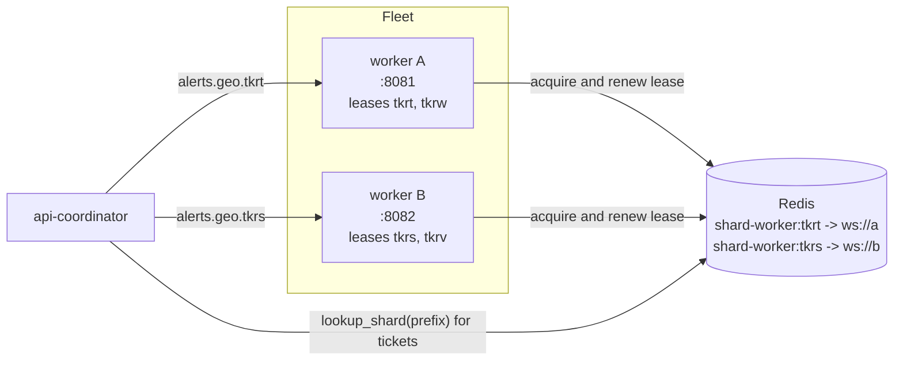

Example on one machine (environment variables override `.env`):

```bash
# worker A
FANOUT_WORKER_PORT=8081 \
FANOUT_WORKER_SHARD_PREFIXES=tkrt,tkrw \
WORKER_PUBLIC_URL=ws://localhost:8081 \
cargo run -p fanout-worker

# worker B
FANOUT_WORKER_PORT=8082 \
FANOUT_WORKER_SHARD_PREFIXES=tkrs,tkrv \
WORKER_PUBLIC_URL=ws://localhost:8082 \
cargo run -p fanout-worker
```

In PowerShell, set the variables first (`$env:FANOUT_WORKER_PORT='8082'` and so on) and then run `cargo run -p fanout-worker`. `docker-compose.scale.yml` does the same with containers.

Rules to keep in mind:

- **Prefixes must be disjoint across workers, and the lease enforces it.** A worker that finds one of its prefixes already leased by another live worker refuses to start. The lease is renewed in the background and released on a graceful shutdown; after a crash it expires after `SHARD_LEASE_TTL_SECS`.
- Set **`WORKER_PUBLIC_URL`** to an address clients can actually reach; it is what tickets hand out.
- A device whose shard has no running worker gets `ws_url: null` and should retry.
- Coordinators are stateless; run as many as you need behind a load balancer.
- Workers do not need the JWT secret or Postgres: they trust tickets and the coordinator's Redis records.

---

## 21. Known Limitations & Honest Caveats

These are listed so no one mistakes the system for something it isn't.

**Measurement and testing**

1. **One benchmark run on one machine.** See [§18](#18-load-testing--results). Quote no number from this repository as a capacity claim.
2. **No automated tests for TLS, real devices, multiple hosts, or failure of Postgres, Redis or NATS** beyond the worker-restart and timing cases in [§15](#15-reliability--failure-behavior).
3. **The CI workflow, including the Docker build, only proves what it runs.** It is configured in `.github/workflows/ci.yml`; check the Actions tab for the current result.

**Behavior and design**

4. **Routing publishes to extra shards for small circles** ([§7.5](#75-what-this-does-and-does-not-guarantee)). It is safe, never misses a shard the circle touches, and costs a few extra NATS publishes per alert.
5. **Live delivery is best effort.** A full per-device queue drops that alert for that device; recovery needs a reconnect and a replay inside the retention window (`ALERT_STREAM_MAX_AGE_SECS`, default one hour) and the replay limit (`REPLAY_MAX_ALERTS`, default 50, newest kept).
6. **No exactly-once guarantee** ([§15](#15-reliability--failure-behavior)).
7. **`total_devices_notified` in the dispatch response is a Postgres count** of registered devices, not a count of live deliveries ([§13.5](#135-post-alerts)). Use the telemetry or `GET /alerts/{id}` for live numbers.
8. **After a worker crash, tickets name the dead worker until its lease expires** (default 30 s).
9. **Operator keys are shared static secrets**, with no per-person identity or audit trail, and registration is open (rate limited only).
10. **No TLS in the repository**, and Postgres, Redis and NATS are single instances in Compose.
11. **The dashboard shows real device positions** to anyone with an operator key (capped at 500 per request) and needs internet access for Leaflet and map tiles.

**Operations**

12. **The compose app services read `.env.docker`, not `.env`.** Create it with `.\scripts\gen-secrets.ps1 -Docker` ([§12.5](#125-run-everything-in-docker)). Its secrets differ from `.env`, so a host-run process and a container do not accept each other's tokens.
13. **Registering many devices at once is slow on a dev machine** (database pool contention, [§18.4](#184-what-this-does-not-show)).
14. **The Docker build is a full release compile** and takes many minutes without a warm BuildKit cache.
15. **The Rust version is pinned** (`rust-toolchain.toml`, CI, Dockerfile). Upgrading is a deliberate change: bump all three, fix whatever the new lints report, commit.

---

## 22. Roadmap

**Done**
- [x] Per-device distance filter in the worker for circle-accurate delivery
- [x] Durable delivery with NATS JetStream: acknowledgements, cursors, replay on reconnect
- [x] Connection ids so a newer connection is never removed by an older one's cleanup
- [x] Shard leases with renewal and release on shutdown
- [x] Operator authentication for `POST /alerts`, `/admin/*` and the dashboard
- [x] One-time WebSocket tickets; shard and position taken from the server, never the client
- [x] Device revocation and deregistration endpoints
- [x] Optional asymmetric (Ed25519) token signing
- [x] Readiness probes; data retention
- [x] Redis and NATS testcontainers; automated end-to-end tests in CI
- [x] Multi-worker benchmark harness (on one host)
- [x] Live map dashboard with per-shard delivery reports

**Next**
- [ ] Exact shard routing (distance from the center to the nearest point of each cell) so small circles publish to fewer shards
- [ ] Per-operator identities, key rotation and an audit trail of who sent which alert
- [ ] TLS termination and deployment manifests (Kubernetes / Helm); worker autoscaling by connection count
- [ ] Benchmarks at higher device counts with repeated runs, and on separate hosts
- [ ] Failure tests for Postgres, Redis and NATS outages; high-availability setups for all three
- [ ] Richer metrics and alerting rules (per-shard delivered and dropped, dispatch latency histograms)

---

## 23. Tech Stack Summary

| Layer | Choice | Why |
|---|---|---|
| Language | **Rust** (pinned by `rust-toolchain.toml`) | Memory safety, no GC pauses, strong concurrency story |
| Async runtime | **tokio** | De facto standard; the rest of the stack builds on it |
| Web / WebSocket / SSE | **Axum 0.8** | HTTP, WebSocket and Server-Sent Events in one framework, tower middleware ecosystem |
| Database | **PostgreSQL 16 via sqlx 0.9** | Durable device registry and audit trail; embedded migrations; SQL circle queries |
| Cache / coordination | **Redis 7 via deadpool-redis** | Shard leases, one-time tickets, device locations, revocations, presence, replay cursors |
| Messaging | **NATS 2 with JetStream (async-nats)** | Low-latency live fanout plus a durable, replayable alert stream; subject hierarchy maps onto geohash prefixes |
| Geospatial | **`geohash` crate + custom BFS/haversine** | The routing logic itself is the novel part |
| Concurrency primitives | **concurrent maps, bounded `tokio::sync::mpsc`, broadcast channels** | Sharded connection registry; per-connection backpressure; in-process fan-out of telemetry |
| Auth | **jsonwebtoken** (HS256, optional Ed25519), one-time tickets, operator API keys | Stateless device tokens; tickets keep tokens out of URLs |
| Validation | **validator** | Declarative request validation |
| Rate limiting | **tower_governor** | Per-IP token buckets |
| TLS provider | **rustls (ring)** | Installed explicitly at startup |
| Observability | **tracing + tracing-subscriber**, hand-rolled Prometheus text | Structured logs with env-filter; request ids on log lines |
| Dashboard | **Leaflet** (pinned, from cdnjs), Server-Sent Events | Live per-shard view, embedded in the coordinator binary |
| Load testing | **tokio-tungstenite + hdrhistogram + reqwest + clap** | Models sustained authenticated WS connections, which generic HTTP load tools don't |
| Tests | **testcontainers** (Postgres, Redis, NATS) | Isolated, reproducible infrastructure per test; real services in-process for end-to-end |
| CI / containers | **GitHub Actions, Docker (BuildKit)** | Lint, tests and image build on every push |

---

## 24. Design Decisions & Trade-offs

| Decision | Rationale | Trade-off |
|---|---|---|
| **Geohash prefix as shard key** | Deterministic, no lookup table; neighbors are computable; maps 1:1 onto NATS subjects | Cells are rectangles with latitude-dependent widths; hot cities create hot shards |
| **4-char shard prefix** | ~39 × 19.5 km is large enough to avoid thousands of tiny shards, small enough to keep one worker from owning a country | Coarse routing, made exact by the worker's per-device circle test |
| **Pub/sub per shard, not per device** | Coordinator publishes O(shards) messages regardless of audience size | Fan-in to workers must then be efficient (it is, in memory) |
| **Generous routing slack** | Never misses a cell the circle touches | Extra, empty shard publishes for small circles |
| **Worker filters sockets by the exact circle** | Precision does not depend on shard size | One distance check per socket in the shard |
| **`try_send` into bounded queues** | One slow client can never stall the fanout loop | Lossy under backpressure by design; replay covers reconnects |
| **JetStream for alerts, plain subscription for live delivery** | A single publish both reaches live subscribers at core-NATS speed and is stored for replay | One more moving part (JetStream storage) |
| **Replay cursor = last acknowledged `created_at`** | Simple, monotonic, survives worker restarts | Needs the 60 s clock-skew margin and an exact cut afterwards |
| **One-time tickets instead of tokens in the WebSocket URL** | Credentials never end up in access logs; a leaked ticket is useless after one use or 30 s | An extra HTTP round trip before every connect |
| **Worker trusts the coordinator's Redis record, not the client** | A client cannot claim another shard's alerts | The worker depends on Redis at connect time (`503` if it is down) |
| **Shard leases with TTL** | Disjoint ownership is enforced, and a crashed worker's claim expires | A crashed worker is named in tickets until the lease lapses |
| **Per-shard independent publish with 207** | Partial delivery is visible and retryable instead of a blanket 500 | Callers must handle `failed_shards` |
| **Durable publish with a timeout, in parallel** | A hung alert is worse than a fast failure, and an outage costs one timeout, not one per shard | A transient slowdown above 3 s counts as failure |
| **Persist the alert before publishing** | Audit trail exists even if dispatch partially fails | An alert row can exist with zero delivery rows |
| **Pure `domain` crate with the wire protocol in it** | Shared, framework-free logic; token, subject and message shapes can't drift | A bit more indirection |
| **Services as libraries with a thin `main`** | End-to-end tests run the real coordinator and worker in-process | A slightly larger public API surface |
| **Dashboard over SSE read with `fetch`** | Works with the `X-API-Key` header, which `EventSource` cannot send; no WebSocket needed for one-way data | Hand-written SSE parsing in the page |
| **Strict CSP on the dashboard, static assets embedded in the binary** | The page handles an operator key; one binary to deploy | Leaflet and tiles still come from third parties |
| **One isolated stack per end-to-end test** | Tests cannot interfere with each other | Slower; at most two stacks run at once |
| **Pinned Rust toolchain** | Reproducible builds and no surprise lints in CI | Upgrades are manual |
| **Hand-rolled metrics** | Fewer dependencies | Minimal metrics until expanded |

---

## 25. Troubleshooting

| Symptom | Likely cause | Fix |
|---|---|---|
| `DATABASE_URL not set` (or `REDIS_URL` / `NATS_URL` / `JWT_SECRET`) at startup | Missing `.env` or env var | Copy `.env.example` to `.env` (or run `.\scripts\gen-secrets.ps1`); run from the repo root |
| `FANOUT_WORKER_SHARD_PREFIXES must list at least one prefix` | Empty/missing prefix list | Set it, e.g. `tkrt,tkrw,tkrs,tkrv` |
| Worker refuses to start because a shard is already leased | Another worker, or a crashed one whose lease has not expired | Stop the other worker, wait `SHARD_LEASE_TTL_SECS` (default 30 s), or delete the `shard-worker:<prefix>` keys in Redis |
| `ws_url` is `null` in a ticket | No running worker leases the device's shard | Start a worker whose `FANOUT_WORKER_SHARD_PREFIXES` includes it, or retry later |
| WebSocket connect returns **401** | Ticket expired (30 s), already used, or the device was revoked | Ask for a new ticket and connect immediately; tickets are single use |
| WebSocket connect returns **403** | The ticket belongs to a different device than the path id | Use the `device_id` and the ticket from the same device's token |
| WebSocket connect returns **409** | The device's location is not known | Request a new ticket; if it persists, re-register the device |
| WebSocket connect returns **421** | This worker does not lease the device's shard, or your `shard_prefix` hint is stale | Use the `ws_url` from a fresh ticket; drop the `shard_prefix` parameter |
| `POST /alerts` returns **401** / **403** | Missing or wrong `X-API-Key` | Send one of the keys in `OPERATOR_API_KEYS`; if that list is empty, every privileged call is refused |
| `POST /alerts` returns **207** | NATS unreachable or slow for some shards | Check `failed_shards`, NATS health, and the coordinator logs |
| `429 Too Many Requests` | Per-IP rate limit | Slow down; for load tests start the coordinator with `RATE_LIMIT_DISABLED=true` |
| `loadgen` fails to register or connect devices | Rate limits, or no worker for the shard | Disable the coordinator's rate limits for the test; check a worker is running |
| Alert returns 200 but a device sees nothing | Device not connected, outside the circle, queue full (`dropped`), or connected to a shard that was not targeted | Check the worker log line `alert fanned out to shard` (`delivered`, `dropped`, `filtered_out`) or watch the dashboard |
| Dashboard says "operator key was rejected" | Wrong key | Paste a key from `OPERATOR_API_KEYS` |
| Dashboard map is blank | No internet access for Leaflet or tiles | Check the browser console; the page needs cdnjs and OpenStreetMap |
| Compose says it cannot find `.env.docker` | The container config was never created | Run `.\scripts\gen-secrets.ps1 -Docker` ([§12.5](#125-run-everything-in-docker)) |
| Compose app services can't reach Postgres/Redis/NATS | `.env.docker` was edited to use `localhost` | Restore service names and container ports from `.env.docker.example` ([§12.5](#125-run-everything-in-docker)) |
| Integration tests fail to start containers | Docker not running | Start Docker; `testcontainers` needs it |
| After unpacking changed files, tests still show the old behavior | Cargo compares file times and the new files looked older | Touch the changed files so cargo rebuilds, e.g. `Get-ChildItem crates -Recurse -Include *.rs \| ForEach-Object { $_.LastWriteTime = Get-Date }` |
| PowerShell refuses a downloaded script | The file is marked as downloaded | `Unblock-File .\scripts\<name>.ps1` |
| Port already in use | Another local service | Change the host-side ports in `docker-compose.yml` / `.env` |

---

<div align="center">

**PulseGrid** was built to demonstrate distributed-systems backend engineering in Rust: geospatial sharding, real-time fanout, backpressure-aware WebSocket delivery, durable replay, and secured long-lived connections, with its limitations documented openly.

Repository: [`github.com/MuaazTasawar/pulsegrid`](https://github.com/MuaazTasawar/pulsegrid)

</div>